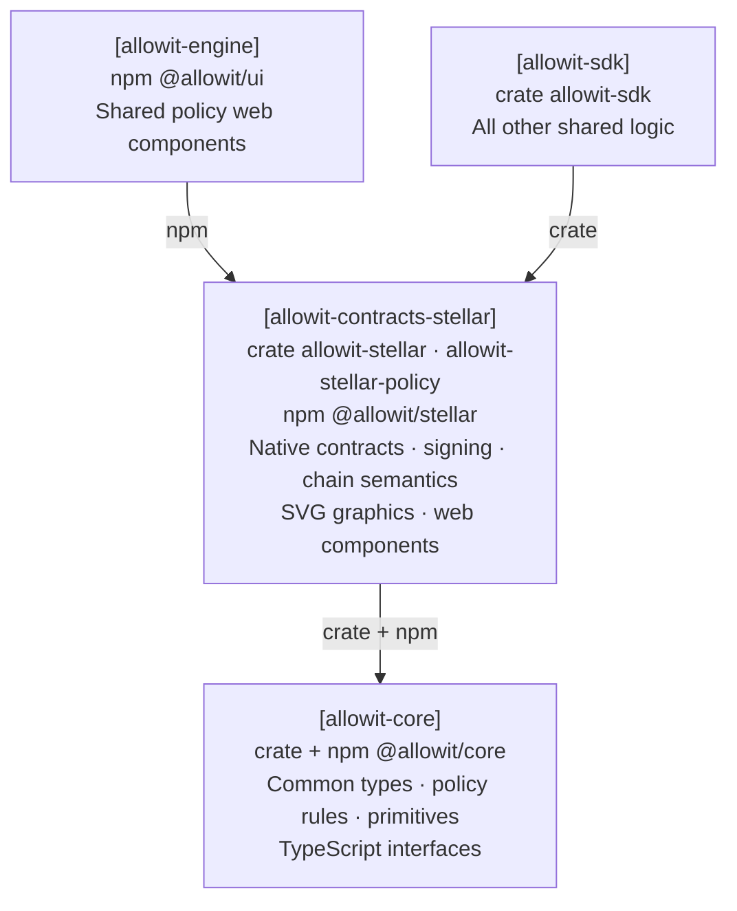

# Stellar rail core

*Prepare, authorize and settle a policy-bound Stellar transfer, deposit or redeem, with the agent and the service each holding their own key.*

`allowit-stellar` is the Stellar rail core. It maps a canonical execution request to an exact Stellar transaction and requires agent and server authorization.
Custody uses the owner's classic G-address account or policy wallet contract. The custody contracts live in [`contracts/`](../../contracts).
The rail's recovery rules preserve the original signed bytes and transaction identity after an uncertain broadcast.

The [SDK engine](https://github.com/allowit-hq/allowit-sdk) composes this crate for both CLI and server callers.
The SDK owns generic orchestration, routing and caller-owned storage.
This crate owns Stellar execution, owner workflows, runtime clients, request validation, formatting,
profiles, diagnostics, signing, simulation, receipts and native recovery rules.
The `provider` module implements Core’s optional `vendor` contracts. SDK Stellar paths reexport it.
Common HTTP/JSON-RPC transport and journal primitives belong to [Allowit core](https://github.com/allowit-hq/allowit-core).
Callers provide RPC, signing and storage bindings. Each actor retains its private keys and policy authority.

Run its checks with:

```sh
cargo fmt --manifest-path crates/allowit-stellar/Cargo.toml --check
cargo test --locked --manifest-path crates/allowit-stellar/Cargo.toml
cargo clippy --locked --manifest-path crates/allowit-stellar/Cargo.toml --all-targets -- -D warnings
```

The optional `test-support` feature supplies native protocol fixtures for consumer integration tests.
Consumer tests provide mock transport, temporary storage and assertions.

The rest of this page is the reference for how the crate behaves.

The `workflow` module owns Stellar native request DTOs and their JSON encoding. `PolicyEngine` selects the Stellar wallet implementation. Generic owner capability traits remain in Allowit core. Fresh preparation and signing require portable source; historical compiler-language packets are decoded only to verify their original hashes, signatures and settlement. Read-only recovery does not rerun current source admission. The caller must bind the packet to its durable original owner-approved record.

`networks::NETWORKS` lists canonical `stellar:testnet` and `stellar:pubnet` identifiers for compiled vendor registration.
`stellar:mainnet` remains a pubnet alias with the same native passphrase and network ID.

## Native key and message signing

`signing::LocalSigner` owns native key decoding, encoding and digest signing.
Its private seed is zeroizing, non-serializable and non-printable. The caller owns private-file storage and signing authority.
`signing::validate_key_identity` checks native public metadata. `verify_digest` verifies the exact native signature.
`signing::signed_message_digest` owns SEP-53 domain separation. `sign_in_message_times` binds the exact owner, Origin and nonce.
The Stellar client checks the native authentication challenge. Core supplies bounded HTTP sessions.
The SDK retains caller-owned authority and generic orchestration.
`signing` supplies the native request-proof domain, scheme and signature-size constants. Core supplies protocol-neutral request framing and freshness checks.

## Architecture

The rail crate owns native encoding, signing and chain semantics. SDK engine depends on vendor
capabilities and core primitives. Shared workflow coordination remains in SDK engine.



[Architecture](../../README.md#architecture).

## Request profile and custody

This crate maps the canonical `ExecutionRequest` to one admitted native operation: a SEP-41 transfer, or a SEP-56 deposit into or redeem from a vault for a policy wallet. A Stellar call is identified by its contract, its function (`transfer`, `deposit` or `redeem`) and its typed arguments; the request's `schema_digest` names no contract schema and is not read. The wallet is the receiver, holder and operator of each SEP-56 call. The one effect bound is the debit: the wallet asset to the recipient or vault, or for a redeem the vault's own shares. `request::transfer`, `request::deposit` and `request::redeem` build these requests from the wallet configuration, the trusted state, an operation ID and typed amounts, and return only a request that decodes. A policy wallet's transaction source and fee payer is the agent address that the wallet holds on the ledger: its fee account ([Fee account](#fee-account)), or for a wallet of an earlier release the agent key's own account. Native classic custody checks the current account weights and applicable transaction and payment thresholds. The 3/1/1 weights and 2/2/3 thresholds are deployment templates, not admission requirements. Classic custody admits only a transfer.

Policy wallet custody calls the layout 4 `execute` entrypoint (`CONTRACT_VERSION` 4). The execute request carries the typed native operation (`AllowitStellarOperation`: `Transfer { token, to, amount }`, `Deposit { vault, assets, min_shares }` or `Redeem { vault, shares, min_assets }`; the wallet is every source, owner, receiver and operator), the installed executable (`module_digest`), `source_hash`, the server-attested `expense` (`Unpriced`, or `Priced` with `AllowitExpenseBounds`, gas in the wallet asset) and the agent's bounded `args` (`Map<Symbol, AllowitValue>`). `ExecutionTerms` holds `args` and `expense`; agent and server sign them with the request. The wallet's `policy_binding` lists the general operations its code runs; preparation of a deposit or redeem checks that list. Rules read a redeem with the vault as recipient, its shares as `token_in` and `amount_in`, the asset as `token_out`, and `min_assets` as both `amount` and `min_out`.

## Fee account

The owner's deployment creates and funds the account that sends the agent's operations on a policy wallet and pays
their network fees. The agent holds a key and no account.

- **Structure.** A fee account has the signers and thresholds of a wallet account: owner weight 3, agent 1, server 1,
  its own key 0, thresholds 2/2/3. The agent key and the server sign from it only together. The owner alone refills
  it, withdraws from it and closes it. The wallet contract names the fee account as its agent address, so the
  contract's agent authorization is the source-account authorization of the fee account. The contract is unchanged.
- **Configuration.** `WalletConfig::fee_account` (`feeAccount`) names it. `agent_account()` is the agent address of
  the wallet on the ledger. A wallet with a fee account takes no x402 authorization: the contract verifies that against
  the raw key of its agent address, and the key of a fee account signs nothing after setup.
- **Derivation.** `owner::fee_account_derivation_message(network, agent, wallet, index)` is the message whose owner
  signature derives the account's one-time key (`WalletKey::from_signature`). It names the network, the agent, the
  policy wallet and an index, and its title differs from the title of a wallet account's message.
- **Setup.** `owner::prepare_fee_account_setup` prepares one transaction from the owner's account: the creation with
  the reserve and the fee float (`fee_account_starting_balance`: 2.5 XLM and 5 XLM) and the three signer operations.
  The owner signs it and the account's own key signs it once. Its owner step has the action `create_fee_account`.
  `RuntimeProvider::prepare_owner` with `OwnerAction::Create` returns that step while the ledger holds no fee account,
  and the wallet creation once the ledger holds it with exactly its roles. An installation without a fee account is
  refused with `fee_account_required` (`details.wallet`), and a fee account with other signers with
  `fee_account_differs`. `owner_intent::OwnerAction::FeeAccountSetup` reconstructs the step from the owner's own
  values; `validate_signed_owner_transaction` takes the owner's signature, then the new account's own.
- **Operations.** The agent key and the server each sign the transaction hash (`sign`); `authorize` assembles both.
  The server signs only after its own authorization of the exact operation, and the rail signs no other bytes.
  `rpc::prepare_with` refuses an operation whose fee account holds less than the declared fee above its reserve, with
  `fee_account_empty` and `details.feeAccount`.
- **Return.** `OwnerAction::Recover` without an amount and a recipient returns the wallet's balance, and when the
  wallet holds nothing, the float of its fee account: one payment from the fee account to the owner, with the action
  `return_fees`. The account stays with its reserve.
- **Earlier wallets.** A configuration without `feeAccount` stands for a wallet whose agent address is the agent
  key's own account. It never stands for a wallet whose agent address is a fee account of the same roles.

`tests/fee_account_authority.rs` submits the setup and each kind of transaction on Testnet under each set of signers
(`ALLOWIT_LIVE_TESTNET=1`, ignored by default).

## Policy tiers and source

`config.tier` selects `simple`, `common` or `custom`. `config.language` is `portable` for every policy wallet. `config.rules` holds the ordered canonical rules: the standard prefix for Common, none otherwise. `config.params` holds the owner params at installation: the canonical keys of `policy::param_keys` plus Custom keys. `config.sourceDigest` is the standard prefix digest for Simple and Common, and the SHA-256 of the source for Custom. `config.server` is the independent G-address service signer.

`policy::source_shape` re-exports the Core portable gate: one self-contained file, `allowit` as the only path root, the macro, attribute and identifier allowlists, and one `pub fn execute(ctx: &AllowitContext) -> allowit::Result`. It returns the standard prefix, whether the source is canonical-only and whether it writes state. `policy::params_from_json` matches `scripts/contract_admin.py` `params`, and `policy::policy_rules` matches its `policy_rules`. `tests/policy_vectors.rs` replays native param vectors and checks native owner binding to the shared gate. Generic Rust/Python source-gate vectors live in Core. SDK engine supplies shared host compilation from Core resources. The server retains trusted admission and publication authority.

`policy::evaluate` runs a policy on the host as the wallet does. A Common wallet runs its standard prefix first. A canonical-only source, or any source with a compiled evaluator, then runs in full. Otherwise the result is `Evaluation::Prefix`: only the onchain part ran.

A classic account enforces nothing onchain. A canonical-only source runs in full on every prepare and sign path, over canonical params. Any other source, such as one that calls a server function, takes the bounded params of a Custom policy, so it can hold the owner's text for that function. Such a source is server policy source, and `policy::classic_shape` checks it with Core's server policy profile: a server function reads the text of an owner param with `as_str()`, which no contract source can. The owner client, the agent's client and the source approval check the source of a classic account with the same profile; the host's gate decides which server functions its build links. The agent's client prepares and signs an operation of such a source without an evaluator: its result is `Evaluation::Prefix`, and the agent's signature alone moves nothing. The server admits the exact prepared operation with `admit_classic`, through `authorize_preparation` with the compiled evaluator of the source, and that admission refuses a result that is not the full evaluation. The host must call it before it stores the operation and must sign only a stored operation: `sign_with` cannot tell whether the admission ran. A source that writes state stays refused, because a classic account stores none.

A Simple or Common wallet takes a source that is more than canonical rules, such as one that calls a server function (`allowit::decision`, `allowit::fetch` and the others that only a server runs): the contract runs its standard prefix or no rule, and the server evaluates the whole source through the evaluator of `authorize_preparation` before it co-signs. The owner client admits a generated draft of such a source on the policy wallet profile; the host decides which sources it binds to which wallet kind. A Custom wallet compiles its whole source, so no server function runs for it.

## Price observation

The rail registers one policy function, `price` (`provider::price`), for `allowit::price` of a server policy. The host sends `{"network", "from", "to", "amount"}` and, when it states its band, `"price"` and `"slip"`; amounts and prices are decimal text. The function answers `{"price", "depth", "tradeAverage", "trades", "observedAt", "source"}`, and the host applies the band. It reads the public Horizon of the network with three requests:

- the root: the newest ledger that Horizon ingested. Its close time is `observedAt`, so a Horizon that lags gives a stale observation;
- the order book of the pair: selling `amount` of `from` consumes its bids, best price first. `price` is what they pay for the whole amount, in units of `to` for each unit of `from`, scaled by 10^7. `depth` is the units of `from` that the bids inside the band buy, at or above its lower bound and at or below its upper bound, or that every bid buys when the host states no band;
- the newest 20 order book trades of the pair: `tradeAverage` is the volume-weighted average of those that closed in the hour before that ledger or after it, and `trades` is their number.

It reads the direct order book only: no path through another asset and no liquidity pool. An asset is `native`, `CODE:ISSUER`, the code of a listed token, or the Stellar Asset Contract id of the native asset or of a listed token. The contract id of another asset does not tell its code and issuer, so it names no order book. The tests replay recorded answers of the Testnet Horizon (`src/provider/price_fixtures/`).

## Custom wallet build

`plugin::PLUGIN.custom_wallet_build()` is the rail's implementation of Core's "build custom wallet" hook
(`allowit_core::vendor::custom_build::CustomWalletBuild`, [`src/provider/custom_build.rs`](src/provider/custom_build.rs)).

- `build(network, source, work)` builds the `AllowitCustomPolicy` Wasm from the exact bytes of the policy source.
  The crate embeds the contract workspace of its own revision. The build writes that tree to `work/tree` with the
  source as `contracts/allowit-custom-policy/policy/policy.rs` and runs
  `stellar contract build --locked --package allowit-custom-policy`. `work/target` keeps the compiler cache.
  The build compiles the same files as `scripts/build-custom-policy.sh` does from a checkout of the same revision, so
  the same source, Rust toolchain and Stellar CLI give the same Wasm. Only source that passes the portable policy
  gate is compiled.
- The build needs Stellar CLI 28.1.0 (`stellar` on `PATH`, or the binary that `STELLAR_BIN` names) and rustup, which
  installs the pinned compiler and the `wasm32v1-none` target from `rust-toolchain.toml`. A missing tool or another
  CLI release is a `custom_toolchain_missing` refusal that says what to install. A failed compile is
  `custom_build_failed`.
- `code_hash` is the SHA-256 of a wallet Wasm of the current custody layout: the hash of the code on the ledger.
- `sign_message` and `verify_message` are the SEP-53 message signature, the one that a browser wallet makes with
  `signMessage`. The server presignature and the owner attestation of a build use it, so a local key and a browser
  wallet sign the same statement.

The rail reports a wallet whose code on the ledger differs from the code of its configuration with the problem code
`custom_code_hash_mismatch`. `OwnerProvider::custom_build` reads the owner's view of a build from the server.

## Wallet kinds, units and settlement reports

The plugin offers the four Core wallet kinds on every network. `native` is the classic account route. `simple`,
`standard` and `custom` are the policy wallet tiers `simple`, `common` and `custom`: the selection id `standard`
names the Common tier. `provider::profiles::wallet_kind` reads the kind of a wallet configuration, and the profile
binding reports it through `Profile::wallet_kind`.

`RailPlugin::native_asset` returns XLM with seven decimals. `RailPlugin::asset_display` accepts `native`, a listed
code, `CODE:ISSUER`, an issuer of a listed token and the Stellar Asset Contract id of a listed token. Another classic
asset shows its code with seven decimals. An unlisted contract is an error, never a placeholder unit.

A settled `exec` or `status` outcome carries `settlement` in its document: `height` is the receipt ledger and `fee`
is the fee that the transaction result charged, in XLM. A receipt of a fee-bumped transaction holds the inner result,
which charges no fee, so its outcome carries no `settlement`. `settlement.amount` is the one debit of a confirmed
transfer or deposit, in the installed asset. A redeem debits vault shares, which have no listed unit, so its amount
is null. A document with a verified receipt also carries `explorer`, this rail's link to the transaction.

Every execute and status request adds the query `include=limits`, which is outside the request proof. The engine then
adds `feeCharged` and `limits` to its reply, and the client copies them to the outcome document: `feeCharged` is the
fee that the spending limits count, and each entry of `limits` is `{param, limit, spent, remaining}`. Each amount is a
quantity `{units, asset, text}` of the installed asset. These values are engine statements without a chain proof. The
client accepts only quantities of the installed asset, builds their text itself and drops a report with an invalid
entry.

`ExecutionProvider::limits` reads the counted limits of a wallet from `POST /api/native/limits`. The body is
`{"policyId"}` and the request proof binds that path and body, so a wallet without an operation reads its limits.
`provider::execution::wallet_limits` returns the same read as `WalletLimits`: `limits`, and `payment_limits` with one
`{param, limit}` entry for each limit on one operation, such as `payment_limit`. Such a limit keeps no counter. A
list that the engine omits is `None`: a counter that the engine could not read is never shown as unused. A refusal of
the route keeps the engine's code and message, for example 409 `params_differ_from_wallet`. An engine without the
route answers 404; the client then reads the status of the newest operation that the journal retains for the policy,
and a wallet without a retained operation has no report.

A 409 `operation_unresolved` or `operation_changed` leaves the operation open: a status poll reads the same request ID
again until the wait ends, then returns exit code 5 with the engine's code and message. A 409 `operation_refused` is
the engine's refusal of a preparation or submission, with the engine's message. After a refused submission the client
reads the status within the wait, because only the status proves that the engine sent nothing. A 409 without a code,
from an engine that does not type its conflicts, is read as `operation_unresolved`.

Server replies are read strictly where they hold signed or bound data: `prepared`, `operation`, `signedOperation`
and `receipt` of an execute reply, the `runtime.instanceBinding` of a policy, a `config`, an owner `step` and a
public wallet profile refuse an unknown field. Their top-level reply objects accept `walletKind`, and an execute or
status reply accepts `paymentLimits`. The reply of the limits route is display data and accepts every other field. A public wallet
profile accepts a top-level `walletKind` only when it is the kind that its `config` binds.

Generation sends the owner's wallet kind as the top-level `walletKind` of the request and keeps the top-level
`walletKind` of the returned policy. A typed refusal such as `wallet_kind_unsupported` keeps its `details`.
`RailPlugin::draft_params` returns the params and the installed asset of a draft, a policy, a public wallet profile
or an installation for display.

`exec` waits up to 180 s for the prepare answer and up to 180 s for the submit answer. `wait` bounds only the engine
status reads after the submit answer: each later read ends at the deadline and the last outcome is returned.
A submit that stops early would leave its outcome unknown, so no caller bound ends it. `status` reads once without a
bound and then polls within `wait`. A status answer that reports a released policy wallet operation starts the lapse
proof on the caller's RPC; that proof keeps its own 30 s call timeouts and is not cut at the deadline. Long steps report through `allowit_core::client::progress`.

A refused owner submission keeps the server `code` in `Error::api_code`. `owner_transaction_expired` and
`owner_transaction_settled` are certain (exit 4). `owner_transaction_pending`, no answer and an untyped server error
are uncertain (exit 5). `network_unavailable` with `details.retry = "same_request_id"` is exit 7.

## Paid services (x402)

`provider::paid_service` implements the Core paid-service hook for x402 sellers on Stellar.

`challenge(network, resource, reply)` reads a seller's HTTP 402 reply: the JSON body with `accepts`
(x402 version 1) or the base64 JSON of the `PAYMENT-REQUIRED` header (version 2). It returns the first
requirement of the selected network that this rail can settle. Validation is strict:

- `network` is the selected network or one of its aliases. A requirement of another network is skipped.
- `scheme` is `exact`.
- `asset` is the Stellar Asset Contract id of a listed token. A seller that takes the proof of a settled
  transaction may also write `native`. Another contract is refused.
- `payTo` is a canonical G or C address.
- The amount (`amount`, or `maxAmountRequired` in version 1) is a positive integer of base units.
- A named resource equals the requested URL.
- `extra.challengeId` or `extra.nonce` is the challenge id. `extra.expiresAt` is a Unix time.
- The accepted terms are at most 4096 bytes of JSON. The proof echoes them, so larger terms are refused.

The agent's transfer goes through the policy and the engine like any other operation. A requirement
states who settles it (`Challenge::settled_by`):

- **The seller** (`SettledBy::Seller`): the standard `exact` scheme of version 2. The payer signs one
  authorization entry for exactly the transfer, and the seller's facilitator submits it in its own transaction
  and pays the network fee. `maxTimeoutSeconds` becomes `Challenge::settle_within`; a requirement without
  it gets 60 seconds, the default of the settlement service. A requirement with
  `extra.areFeesSponsored: false` is refused: the scheme defines no other fee payer.
- **The payer** (`SettledBy::Payer`): the seller states `extra.proof: "settled-transaction"`. Allowit settles
  the payment itself and presents the settled transaction.

A challenge can list several offers. The first offer that the payer settles is taken, because every wallet
kind can pay it; the first that the seller settles is taken only when the challenge has no such offer.

Another `extra.proof`, and the standard form in version 1, are refused before any payment.

### Payment authorizations (`seller_settled`)

A payment that the seller settles is the ordinary operation with one optional part,
`PreparedOperation::payment_authorization`. Its request (`seller_settled::request`) names the transfer, carries
no fee bound and holds the marker `seller_settled::marker()`. Its payee is an account: a contract payee is
refused when the request is built (`seller_settled::CONTRACT_PAYEE`), and a challenge's offer to a contract
payee is passed over for its next offer. Preparation prepares the same transfer as the
wallet would execute it itself, so the same policy checks decide, and adds the part: the unsigned entry of
exactly `transfer(wallet, payTo, amount)` on the asset contract, and its host payload as the digest.

- **Who signs.** Only a keypair wallet. `seller_settled::signs` is the one place that decides it by wallet
  kind, and `signed_entry` is the one function that produces the signature. The agent and the service each sign the digest (`sign`), and
  `seller_settled::authorize` assembles the entry with both account signatures, checks the wallet account
  against the ledger and simulates the payload in enforce mode. Their weights reach the medium threshold only
  together. A policy wallet is refused with `seller_settled::POLICY_WALLET`: its contract checks an
  authorization against the raw key of its agent address, which is its fee account. The refusal
  names the fix: a Native wallet pays such a seller.
- **What the entry admits.** One transfer of the amount of the asset from the wallet to the payee, once: the
  ledger consumes the nonce, which derives from the operation id. It expires at
  `ledger + (expires_at - created_at) / 6`, at most 64 ledgers.
- **What is presented.** `SignedOperation::transaction_xdr` is a transaction from a placeholder source with
  the one invocation and the signed entry. It has no signature, and `rpc::broadcast` refuses it. The outcome
  document holds it as `paymentAuthorization.transaction`, and `proof` builds the standard payload
  `{x402Version, resource, accepted, payload: {transaction}}`.
- **Ledger of the preparation.** The expiry ledger counts from the ledger that the preparation names. Each
  signer checks that ledger against its own endpoint first (`seller_settled::current_ledger`): a ledger more
  than five ahead of the signer's read is refused, so no party gets an entry that outlives its operation.
- **Day.** The limits count a payment in the UTC day of its preparation. The operation of an authorization
  expires at least ten minutes before the end of that day (`seller_settled::DAY_MARGIN`), so its ledger
  closes inside the day while ledgers close within that margin. Later in the day no authorization is signed
  (`seller_settled::DAY_END`).
- **Expiry.** The entry expires at a ledger: the ledger of the preparation plus one ledger for each six
  seconds of the operation's validity, at most 64. The ledger binds an entry to no time, so a ledger that
  closes late lets the transfer settle after the operation's expiry. The policy is therefore asked twice: for
  the operation, and for the same operation expiring one day later (`seller_settled::EXPIRY_MARGIN`). A
  policy whose time limit falls inside that margin signs no authorization (`seller_settled::TIME_LIMIT`). A
  network that stops for longer than the margin is outside this bound.
- **Outcome.** The service sends nothing. `seller_settled::observe` reads the asset contract's `transfer`
  events from the wallet to the payee, from the ledger of the preparation through the expiry ledger. A
  successful transaction whose one invocation is the transfer that the exact entry authorizes, with that
  entry as its only authorization, settled it: its receipt has `VerifiedReceipt::settles`, and the operation keeps its
  own `transaction_hash` as its identity. The ledger admits an entry that no call uses, so a transaction
  that only carries the entry settles nothing; one that carries it in another shape leaves the outcome open.
  The read follows the event cursor to an empty page, whose cursor names the last ledger that the endpoint
  scanned: it is complete when that ledger is the expiry ledger or a later one, or when an event after the
  expiry ledger was reached. A complete read without a transaction that carries the entry proves the lapse
  (`Status::Failed` without a receipt). A reported transfer whose transaction the ledger does not return
  keeps the outcome open. The wallet paid no fee: the receipt reports none.

### Settlement service (`settlement_service`)

`settlement_service::SERVICE` implements the Core settlement-service hook: the checks and the submission of a
facilitator of the `exact` scheme. `verify` reads `{paymentPayload, paymentRequirements}` and checks, before
anything is submitted:

- version 2, scheme `exact`, the served network, and the payload's accepted network;
- one `invokeHostFunction` operation that calls `transfer(from, payTo, amount)` on `asset`, with exactly the
  required payee and amount;
- exactly one authorization entry: address credentials of `from`, signed, for exactly that call, with no
  sub-invocation, expiring within `maxTimeoutSeconds / 5` ledgers plus two;
- the service's own account is not the transaction source, the operation source, the payer or the
  authorizer;
- the enforce-mode simulation succeeds, its resource fee plus the 100-stroop inclusion fee is at most
  `Limits::max_fee`, and its committed events are exactly one `transfer` of the asset from the payer to the
  payee of the amount. An event of a call that failed inside the transfer is rolled back and not counted.

`settle` checks again, builds its own transaction (its account as the source, the simulated resources and
fee, the invocation and the entry unchanged), signs it, sends it and reads the receipt within `Limits::wait`.
The replies have the standard form: `{isValid, invalidReason?, payer?}` and
`{success, errorReason?, payer?, transaction, network}`. A transaction that is sent and not confirmed in
time is `settlement_pending` with its hash; `observe` reads it again. A successful transaction is a
settlement only when its committed contract events are that one transfer: a token can act otherwise in the
ledger than in the simulation. A successful transaction with other events answers `success: false` with the
reason and its hash. Without the committed events, the answer stays `settlement_pending`. A transaction that
the network did not take is `settle_exact_stellar_transaction_submission_failed`: nothing was sent. `observe`
answers `settle_exact_stellar_transaction_not_included` when the ledger does not know the hash after the
ledger bound of the transaction and the endpoint's history covers the span in which the service can have
sent it. The transaction carries that bound: one ledger after the expiry ledger of the entry, so no later
ledger takes it, even as a failed one.
The service signs the hash of its transaction: a caller that keeps what it signed has the hash before the
transaction is sent.

For a payment that the payer settles, `proof(challenge, receipt)` builds the request header from the outcome
document of the confirmed operation: `X-PAYMENT` (version 1) or `PAYMENT-SIGNATURE` (version 2), the base64 JSON of
`{x402Version, scheme, network, payload: {transaction, settled: true, challengeId?}}`. Version 2 also
echoes `accepted` and `resource`. The receipt must be confirmed, its `network` must be the network of the
challenge, and its recorded `paidService` context must equal the challenge: the resource, the recipient, the
amount and the asset. A receipt without that record gives no proof. A stated `settlement.amount` must also equal the challenge amount; a fee-bumped
transaction states none.

A seller that accepts this proof verifies it on its own:

1. The transaction `payload.transaction` succeeded on the stated network.
2. It moved at least the required amount of the required asset to `payTo`.
3. It closed after the seller issued the challenge.
4. Its hash was not used for an earlier delivery.

`exec_paid` sends the `paidService` context with the preparation of the transfer. The engine checks it
against the operation and records it with the request ID. The journal keeps it with the original intent:
a retry or a recovery of the same request ID with another context is refused before anything is signed.
The journal also keeps the ledger endpoint of the client. A recovery of the record reads the ledger through
it, so a status read of a retained request can prove that a payment authorization lapsed.
The outcome document of a paid operation shows the recorded context under `paidService` and the wallet's
network under `network`.

## Owner setup

`admin::PolicyConfig::for_policy` builds the `AllowitPolicyConfig` constructor packet of a validated installation, and `constructor_args` emits it. `admin::Deployer` prepares unsigned setup transactions through Stellar RPC simulation:

- `upload_wasm` prepares `UploadContractWasm` of wallet code that declares custody layout 4 (`check_wallet_code`).
- `create_wallet` prepares `CreateContractV2` with the constructor packet. The owner is the transaction source and must be owner-only. `wallet_address` derives the wallet address from the owner and salt.
- `fund` prepares one exact SEP-41 owner-to-wallet transfer, within the installed fee ceiling.
- `extend_wallet` prepares instance/code renewal to the independently observed network lifetime limit.

`admin::PolicyInstallation::wallet_config` derives the native asset contract, source binding, rules and wallet address from admitted public installation inputs. `admin::wallet_salt` preserves the policy-instance address domain. `PolicyValue::from_core` and `to_core` preserve the common value variant and check native address encoding. SDK adapters convert common inputs here. They retain source admission, orchestration and storage.

Funding and renewal return `owner_intent::OwnerTransaction` after native simulation and complete intent validation. They neither sign nor submit. Fresh builders date source and simulation observations with bracketing native heads. An observation may trail the closing head by at most five ledgers, because one public RPC call can take a full ledger close. They reread the source before returning and reject changed accounts or stale resources.

`rpc::observe_account` exposes the dated account separately. Native network identity admits the pubnet/mainnet alias while packet fields retain the selected config spelling. `PreparedOwnerOperation::owner_transaction` refuses a pending owner handoff. Its metadata conversion grants no signing authority.

Before presenting funding or renewal and again before signing, SDK callers independently match current destination custody, source, code, parameters, roles, asset and pause state. A successful asset transfer simulation does not attest its recipient. The native unsigned builder can construct funding for an absent destination. Callers decide automatic renewal eligibility with `WalletLifetime::needs_renewal`. These preparations neither authorize a signature nor release a reservation.

`rpc::code_uploaded` and `contract_exists` check exact live entries at a current ledger. A missing live entry does not prove it never existed. `rpc::owner_settlement` observes the original transaction hash. A missing hash remains `Unknown`, including after expiry. Only a verified native success or failed receipt is terminal. Supplied response hashes and native ledger ranges must agree with that receipt.

SDK callers retain the original packet and own retries. `rpc::vault_redeemable` reads SEP-56 valuation without authorizing a transfer. `rpc::simulation_fault` reads only the terminal contract error code. Events and log hints cannot establish the originating contract. Budget and transport failures remain separate from contract errors.

`admin::validate_auth` admits only the exact authorization scope of the host function. `admin::check_assembled` applies the `contract_admin.py` `prepare_xdr` intent checks to an assembled transaction: an unsigned v1 transaction from the source with one host function, where simulation added only authorization, resources and their fee within the ceiling.

The binary `allowit-stellar-admin` (`src/bin/allowit-stellar-admin/`) is the administration command line: native account setup, shutdown and verification from Horizon state, and contract upload, deployment, read and owner or parent administration through Stellar CLI 28.1.0. It uses these checks, prints unsigned XDR and never signs or submits. See [docs/admin.md](../../docs/admin.md).

Before signing an untrusted owner step, construct `owner_intent::ExpectedOwnerIntent` from the owner's selected policy, reviewed executable, destination and amount. Its limits name the network, owner, independently observed next sequence, fee ceiling and latest expiry. `validate_owner_transaction` compares the complete unsigned XDR and step metadata with that intent. It supports exact Wasm uploads, policy-wallet creation, funding transfers, the params update of an installed wallet, instance/code lifetime renewal and the existing three-operation native setup. Creation checks the selected tier, source binding, params, roles, asset, executable and salt-derived wallet. `validate_deployment` also checks the deployment metadata; `validate_native_setup` also checks the native setup identity digest and complete reconstruction. Server-supplied business fields must not become the caller's expected values.

`OwnerAction::Extend` binds one `ExtendFootprintTtl` operation to exactly the selected wallet instance and executable in the read-only footprint. `extend_to` is a relative lifetime in ledgers, at most `max_entry_ttl - 1`, as specified by [Stellar state archival](https://github.com/stellar/stellar-protocol/blob/master/core/cap-0046-12.md). `rpc::wallet_lifetime` reads the matching current entries and archival limit. The renewal threshold includes the same 17,280-ledger headroom as the owner deployment flow, up to the maximum target.

`rpc::asset_balance` observes the selected asset's `balance(holder)` through an explicit G-account simulation source. It requires one nonnegative native i128 result and an explicit empty authorization list. Missing data, restoration, contract errors and stale or inconsistent ledgers fail. The result includes its observation ledger. Before reporting post-transaction funding, SDK callers require that ledger to be at or after the independently verified transaction receipt. A sign-in session and a source-consent response do not establish deployment or funding.

Validation returns a sealed in-memory proof. Its consuming `sign_with` method sends only the approved transaction hash to a caller-owned signing capability, then strictly verifies the returned owner Ed25519 signature before attaching it. Expired proofs cannot call the signer. Reloaded JSON requires validation again. `admin::sign_owner_transaction` remains a low-level seed helper: it checks unsigned source ownership and does not validate business intent, fees or expiry.

`rpc::send_transaction` sends existing signed bytes once and reports the native broadcast result. SDK engine persists intent and controls polling and exact-byte retries. Native validation and signing neither publish nor submit a packet.

`owner_intent::validate_signed_owner_transaction` matches an external signed v1 envelope to the retained original transaction and network digest. It requires one valid source-owner signature. It establishes no settlement or new business approval. Historical observation imposes no current expiry, role or source-admission gate. Fresh broadcast separately requires current authority and validity checks.

## Service and agent authorization

`authorize_server_using` accepts a declared server public identity and a caller-owned sign-hash capability. It applies the same native preflight and full-policy evaluator gates as the seed helpers before invoking the capability. It strictly verifies the returned signature. The seed helpers delegate to this path and preserve their transaction bytes. SDK adapters can keep private server keys outside the common facade.

`AccountState::validate_roles` checks the fixed classic setup against independently selected owner, agent and server identities. `validate_authority_signatures` checks every distinct current positive-weight Ed25519 signer and the current high threshold. These checks serve fresh admission and signing. Historical packet validation remains separate. the SDK request-proof verifier checks the existing native proof domain against the exact path, canonical body and time. The caller still decides whether that signer can perform the requested action.

For a policy wallet, call `rpc::prepare`, then the service authorization, then `rpc::simulate` again. Initial simulation records authorization on a copy of the intent without auth entries, because Stellar RPC rejects recording mode when entries are present, and checks the recorded scope against the intent's entries. The second simulation enforces the signed service authorization and computes the final resource needs, including the service entry's nonce key. Only then deliver the prepared packet for agent revalidation and signing. Agent and service authority are both required. Direct execution requires an existing Stellar server account whose configured key meets its current medium threshold. Preparation reads that account and checks its quorum; enforce-mode simulation checks actual native authorization. The service authorization changes the transaction hash; the agent signs the final transaction. The service entry's nonce derives from the network, the policy wallet address, the operation nonce, the deployment version and the service key. Soroban tracks authorization nonces per signer, so one service key can serve several policy wallets.

The service evaluates the installed policy on the host before it signs. A Custom wallet runs its whole policy onchain, so native preflight completes it; use `authorize_server(prepared, seed, now, None)`. A Simple or Common wallet runs at most its standard prefix onchain. If its source is not canonical-only, use `authorize_server_with(prepared, seed, now, evaluator)` with the evaluator that the server build gate compiled from `config.policy_source`; a prefix-only evaluation is refused. Layout 4 keeps standard accounting onchain, so `authorize_server` rejects service accounting.

`rpc::revalidate_prepared` revalidates an existing unsigned packet through a trusted RPC without changing its transaction or hash. Fresh resource requirements must fit the existing resources, and quorum is checked on the unchanged original transaction, so an exact-hash preauthorization of the source stays valid.

`rpc::operation_receipt` reads the settled receipts of an operation from the wallet's persistent storage. A transfer has a `TransferReceipt`. A deposit also has a `DepositReceipt` with the settled share credit; its transfer receipt is the underlying debit to the vault. A redeem also has a `RedeemReceipt` with the settled asset credit; its transfer receipt is the share debit at the vault.

Use `rpc::trusted_state_for_discovery` for public network, account and policy wallet binding discovery without requiring a formerly configured customer signer. Its `DiscoveredState` reports both live authority and whether a policy wallet is paused. Discovery does not authorize an operation. `rpc::trusted_state` checks the presented customer key against current authority. Classic custody accounting must come from the durable policy coordinator; a policy wallet reads its standard accounting from the wallet.

The agent key signs from the wallet's agent account. The customer signing key is `config.agent`; the policy wallet transaction source and fee payer are the current agent account in `state.source.address`: the fee account, where the server's signature is needed too. Additional Ed25519, hash, preauthorized and signed-payload keys do not lock out a sufficient current customer quorum.

Classic authorization verifies both customer and server role proofs. `SignedOperation.role_signatures` keeps both proofs, and `validate_signed` and a new `rpc::broadcast` require them, even when the customer weight alone meets the account thresholds. A retained record without role proofs stays valid for status and recovery only. Exact quorum checks include matching transaction preauthorizations; policy wallet checks use the final hash after resource simulation. The transaction envelope contains only the signatures needed by current chain thresholds, including any matching preauthorization, so unused signatures cannot invalidate it. High-threshold administration and owner weights are reported from live state rather than imposed by this transfer profile.

`prepare`, `sign` and `authorize` bind the exact request and signatures. Native transactions bind their operation ID in the hash memo. Soroban transactions use no memo and bind the same identity inside the signed `execute` arguments.

New native and policy wallet bounds start at zero, so a transaction signed before the next ledger closes is never too early. They end one second before the approved expiry: Stellar's `maxTime` is inclusive, while the request expiry, the wallet's `expires_at <= now` check and the portable `expires_at` rule are exclusive. Retained native packets keep their original bounds, `[created_at, expires_at]` or `[0, expires_at]`. Validation preserves those signed bytes for status, recovery and an unchanged resend, and refuses new authorization.

Policy wallet preparation needs resource simulation before signing. Native configuration permits at most 1,000,000 stroops (0.1 XLM) in fees. The policy wallet ceiling is 10,000,000 stroops (1 XLM), because each wallet operation pays rent for a persistent replay entry at the network's longest lifetime. The exact request must cover the installed fee bound. Simulated resource fees plus inclusion fee must fit that bound. Preparation never increases it.

A policy wallet counts gas against its spending limits: the `gas_units` of the expense that the server signs. `rpc::prepare_with` treats the caller's expense as a ceiling and lowers it to the fee that the operation can be charged:

1. It simulates the exact invocation in recording mode with the lowest fee bound, the 100-stroop inclusion fee. The wallet runs its whole policy. A policy that reads the gas can refuse the lowest bound alone, so a refused operation is simulated once more at the ceiling. When the wallet refuses both, the first refusal is the answer.
2. `fee_bound` of the simulated resource fee is the signed bound: the resource fee, the inclusion fee and a 1% margin, rounded up. `ExpenseBounds::with_fee_bound` lowers the gas pro rata and rounds up. For XLM the gas is the bound in stroops.
3. It simulates the invocation again with that expense. This simulation decides the policy, so a debit plus its counted gas above a limit is denied before any signature. When this simulation needs a declared fee above the bound, as a policy that reads the gas can, the bound follows from its own resource fee, within the ceiling, at most twice.

The network charges a transaction at most its declared fee and refunds the unused part of the refundable resource fee: rent, events and the return value. The declared fee is the resource fee of the enforce-mode simulation of the signed entry plus the inclusion fee, and `attach_simulation` refuses a declared fee above the signed bound. The counted gas is therefore never below the fee charged. A recording simulation prices the server's authorization nonce at the longest entry lifetime, so its resource fee covers the enforce-mode fee; the margin covers the rent of the ledgers that close between the simulations. The wallet contract cannot observe the refund, so the counted gas stays above the fee charged by the refund, the nonce surplus and the margin. A settled receipt reports the fee paid as `fee.native_units` and the counted gas as `fee.charged_units` (`rpc::counted_gas_units`); a failed transaction counts nothing. A keypair account has no counters, and its `charged_units` is zero: the engine prices the fee paid through `ServerHooks::charged_fee`.

`validate_retained_prepared` and `validate_retained_signed` verify the original transport, effects, hashes and signatures without compiling policy source. Use them only for read-only history and original-hash recovery. Native transaction signatures do not prove the accompanying policy source metadata. Before calling these helpers, compare that metadata with the original owner-approved binding in the durable record or client token. New preparation, signing and first broadcast still require current policy admission and fresh transaction bounds.

SDK engine retains signed bytes before calling `rpc::broadcast` and reconciles the original transaction hash before any retry. `rpc::status_by_hash` and `rpc::receipt_by_hash` verify native settlement. Native validity checks decide whether retained bytes can be broadcast again. An uncertain broadcast preserves its original identity and reservation; external delivery is a separate result. `rpc::operation_lapsed` proves that a policy wallet operation never executed and never can: a ledger closed at or after its `expires_at`, and wallet entries read at that ledger or later still show the nonce that the packet binds. The agent client reports an operation that the engine released without a receipt as `failed` only with this proof from its own RPC; otherwise it stays `submissionUnknown`. The journal retains the proof with the preparation, so the operation stays `failed` when the wallet nonce later moves or RPC is unavailable.

The signing seed stays with its actor. Wallet configuration contains public installation data. Historical signed packets remain read-only and cannot start new preparation. `rpc::checker_version` requires an explicit shared checker contract address; the service signer is never used as a checker address. Client-held signing material must remain private and is not part of public wallet configuration. Production promotion is a separate operation.

`x402::SigningRequest` describes one exact SAC transfer authorization. Its `WalletState` includes verified custody, tier, pause and owner-enabled x402 state; mismatched or disabled state rejects before digest construction. `signing_digest` derives the contract's domain-separated digest from the network, full authorization tree and native execution request. External agent and server signers review that request and sign the digest independently. `assemble` verifies both signatures and emits the exact `PolicyAuthorization`; it rejects missing, swapped or transplanted signatures. These encoding helpers do not approve a policy or accept payer-supplied state as trusted. Each actor must use current trusted binding and state. The server signs the digest only after `x402::verify_server(request, now, evaluator)` accepts it: it runs `verify_operation` on the exact request and terms and applies the same rule as the service authorization, so a Simple or Common source that is not canonical-only needs its compiled evaluator. The facilitator simulates the final transaction in enforce mode.

The owner must enable x402. Its raw Ed25519 keys need no funded G-accounts. Native account signer or threshold changes do not revoke those raw keys; rotate the wallet's configured keys or disable x402 through an owner-authorized deployment. Direct execution continues to use native account authorization.

`admin::OwnerAdmin` prepares unsigned owner transactions for `deploy_policy` (the next version with new params, rules or owner keys and the installed code), `deploy_code` (the same with uploaded layout 4 code installed atomically), `set_pause`, `recover` and `recover_to`. `deploy_policy_source` prepares the same update bound to a target source, as `contract_admin.py` binds an owner packet to `--policy-source`; a Common rules-only update uses it with the installed code. `PolicyDeployment::for_source` binds a source and params to the installed tier. Each call checks only what the contract entrypoint reads: `recover` reads the kept fields of any readable layout (1 to 4), so a wallet with a broken binding stays recoverable; `set_pause` and `deploy_code` also need the exact layout 4 state; `deploy_policy` also needs the installed executable and policy binding. Preparation simulates each call in recording mode without auth entries, checks that the recorded entries name exactly the required owners (the current owner, plus the new owner for an owner handoff), and puts those entries in the unsigned transaction for the owners to sign.

An owner handoff returns the new owner in `pending_authorizers`. Its transaction cannot be submitted yet, and its hash is provisional. The new owner signs its recorded entry with a `signature_expiration_ledger` after the latest ledger. `OwnerAdmin::complete_owner_handoff` checks that entry and its signature, simulates again in enforce mode for the final fee and resources, and returns the final transaction and hash. The current owner signs only that transaction.

### Params update of an active wallet

An owner changes installed params on an active policy wallet with one signature. The update is one `deploy_policy`
call at the next configuration revision. It keeps the owner, agent, server, source binding, rules, x402 choice and
installed code, and the wallet keeps its policy state and request nonce. The recorded usage therefore stays as it
was: an update neither raises nor resets a counter. Simple, Common and Custom wallets take the update. A Custom
wallet takes any typed value; the server checks the range of a canonical rule.

- Server: `RuntimeProvider::prepare_params_update` reads the installed revision and x402 choice from the ledger,
  refuses an update whose expected revision is not the installed one, and prepares the owner step with the action
  `update_params`. `OwnerRuntime::with_params` returns the installation to store after the step settles.
- Owner: `OwnerProvider::update_params` reads the same facts through the owner's RPC and reconstructs the packet
  from the owner's document with `owner_intent::OwnerAction::UpdatePolicy`. A step with another value, target
  revision, wallet, owner or code never reaches the signer. The workflow resumes under its request ID: it keeps the
  revision that its first run read and sends the saved signed bytes again. Its outcome selects the updated
  installation, and its request ID exports that installation as an activation ID does.
- A request that the agent prepared under the earlier revision is `StaleRequest` after the update; it uses no
  nonce and charges nothing. The signed update applies once: a second submission targets a revision that is no
  longer the next one.

`OwnerProvider::verify` reads the wallet through the owner's RPC, without the server, and compares it with the
owner's document: executable, source binding, rules, params, wallet kind, roles, asset and policy instance. It
returns each comparison and the state read-back: the configuration revision, the pause flag, the params and the
counters (`spent`, `day_spent`, `day`, `calls` and the nonce). Every policy wallet tier commits its usage on the ledger with each operation,
also a Simple wallet, so the counters of a policy wallet are marked `ledger`. A keypair account compares its
signers; the server records its usage, so its read-back holds no counters and is marked `server`.

`OwnerProvider::edit_params` and `revise` send the `micro/params` and `micro/revise` owner routes for an unsigned
draft and check that the reply is the next revision of the same draft on the same wallet binding.
`OwnerProvider::paired_export` returns what the server evaluates (the complete source, its rules and evidence
functions, every param) and what the wallet kind enforces.

`recover` moves the full balance observed at preparation. An agent payment that settles first makes it fail with `InsufficientFunds`. Pause automation with `set_pause` before a recovery.

`RuntimeProvider::prepare_owner` reads `OwnerAction::Recover` by its fields. With an amount it moves that amount to the recipient, or to the owner. With no amount and no recipient it moves everything to the owner: a policy wallet keeps its contract, and a keypair wallet closes, because its account merges into the owner's account and the reserve returns. With no amount and a recipient, a keypair wallet returns every spendable unit and stays: for XLM that is the balance above the reserve of the entries that the account holds and of the agent signer that a paused wallet lacks, so the owner can restore that signer; for an issued asset it is the balance of the trustline. Units that an open offer of the account holds stay. A wallet that holds nothing to return refuses the preparation, and `RuntimeProvider::problem` reports the refusal with the code `nothing_to_return`, for a keypair wallet and for a policy wallet. A host that returns the funds as one step of a larger owner action reads that code as a step that the ledger already shows.
